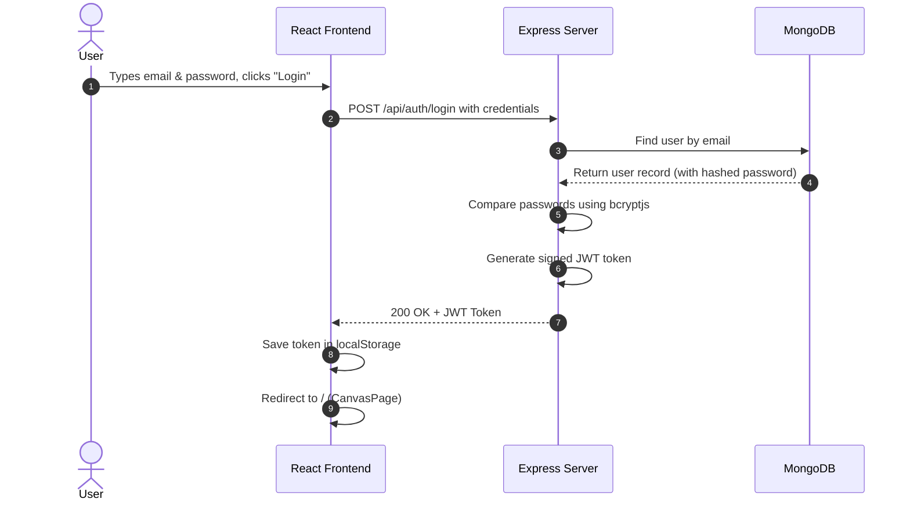
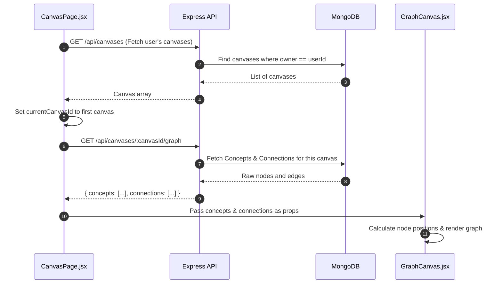
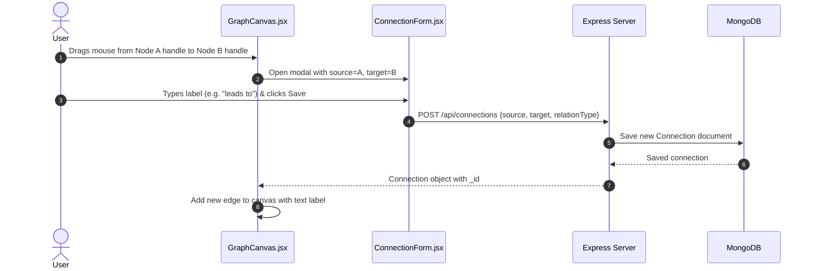
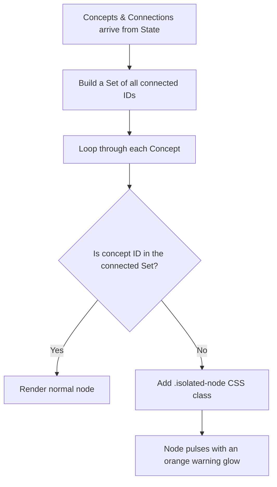
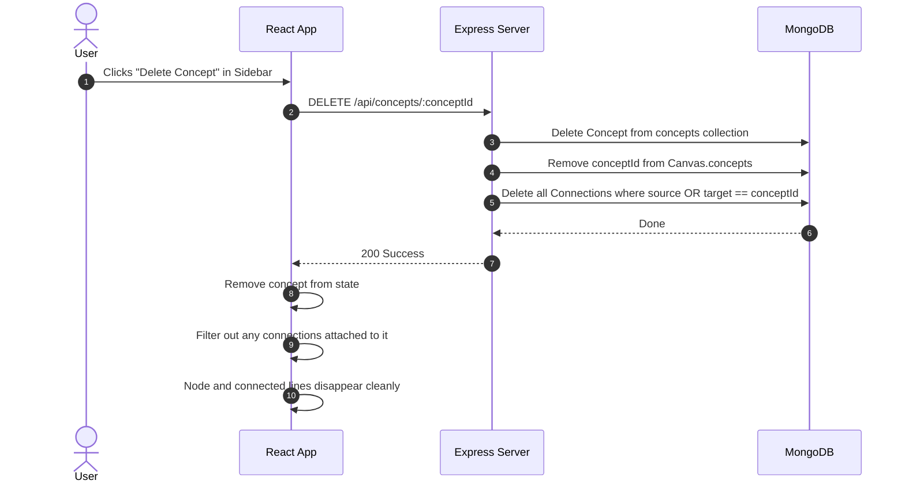

# ConceptMap - Program Flows & How Everything Works

This guide explains the most important program flows in **ConceptMap** in simple, plain English. 

Each flow shows what happens step-by-step from the moment a user clicks something on the screen to how the server and database respond.

---

## Table of Contents
1. [Flow 1: User Login & Authentication](#flow-1-user-login--authentication)
2. [Flow 2: Loading a Canvas and Graph Data](#flow-2-loading-a-canvas-and-graph-data)
3. [Flow 3: Adding a New Concept (Node)](#flow-3-adding-a-new-concept-node)
4. [Flow 4: Connecting Two Concepts (Edge / Relationship)](#flow-4-connecting-two-concepts-edge--relationship)
5. [Flow 5: Moving Nodes Without Them Jumping (Position Stability)](#flow-5-moving-nodes-without-them-jumping-position-stability)
6. [Flow 6: Detecting Isolated Nodes (Warning Aura)](#flow-6-detecting-isolated-nodes-warning-aura)
7. [Flow 7: Deleting a Concept & Cleaning Up Broken Connections](#flow-7-deleting-a-concept--cleaning-up-broken-connections)

---

## Flow 1: User Login & Authentication

This flow explains how a user logs in and stays logged in while browsing.



### Simple Explanation:
1. **User types details**: The user enters their email and password on the login screen (`AuthPage.jsx`).
2. **Sending the request**: The browser sends a `POST` request to `/api/auth/login`.
3. **Checking password**: 
   - The server finds the user in MongoDB.
   - The server does not store real passwords; it stores scrambled "hashes".
   - The server uses a tool called `bcryptjs` to check if the password matches the scrambled hash.
4. **Giving a Digital Pass (JWT)**: If correct, the server creates a secure "key card" called a **JWT token**.
5. **Saving the token**: The browser stores this token in its `localStorage`.
6. **Automatic Pass for future calls**: Every time the browser asks the server for data later, an Axios interceptor (`services/api.js`) automatically attaches this token in the header (`Authorization: Bearer <token>`).

---

## Flow 2: Loading a Canvas and Graph Data

This flow explains what happens right after login when the main workspace opens.



### Simple Explanation:
1. **Fetch user canvases**: When the page loads, `CanvasPage.jsx` asks the server: *"What canvases belong to this logged-in user?"*
2. **Select first canvas**: The server sends back a list. The page picks the first canvas to display.
3. **Fetch the graph details**: The page then calls `/api/canvases/:id/graph`.
4. **Gathering the pieces**: The server looks at the canvas, gets the list of concept IDs, and fetches:
   - All the concept items (titles, levels, tags).
   - All the connection lines between those concepts.
5. **Drawing the board**: The page passes this data to `GraphCanvas.jsx`, which converts them into visible boxes (nodes) and lines (edges) on the screen.

---

## Flow 3: Adding a New Concept (Node)

This flow explains what happens when a user creates a new topic box.

```text
[User clicks "+ Add Concept"]
           │
           ▼
[Fills title, description, & level in ConceptDrawer]
           │
           ▼
[Axios POST /api/canvases/:canvasId/concepts]
           │
           ▼
[Server saves Concept in DB & adds ID to Canvas.concepts]
           │
           ▼
[Client receives new Concept]
           │
           ▼
[GraphCanvas computes deterministic position using hash(ID)]
           │
           ▼
[New Concept Node appears on Canvas without moving other nodes]
```

### Simple Explanation:
1. **User opens drawer**: The user clicks the "+ Add Concept" button. A drawer slides out.
2. **User enters info**: The user gives the concept a name (e.g., *"Quantum Computing"*), a description, and an understanding level (*Beginner*, *Intermediate*, or *Advanced*).
3. **Saving to database**: The frontend sends this to the server. The server creates a new `Concept` in MongoDB and adds its ID to the current `Canvas`.
4. **Updating the screen**: The server returns the newly saved concept.
5. **Finding its spot**: The frontend calculates where to put it on the canvas using a formula based on its unique ID (`getDeterministicPosition`) so it gets a neat starting location.

---

## Flow 4: Connecting Two Concepts (Edge / Relationship)

This flow explains how two concepts get linked together with a labeled line.



### Simple Explanation:
1. **Connecting nodes**: The user clicks a small circle (handle) on Node A and drags a line over to Node B.
2. **Asking for the label**: A popup modal (`ConnectionForm.jsx`) appears and asks: *"What is the relationship between these two?"*
3. **Typing the relation**: The user types a word like *"causes"*, *"depends on"*, or *"leads to"*.
4. **Saving**: The app sends a `POST /api/connections` request to the server with:
   - `source`: ID of Node A
   - `target`: ID of Node B
   - `relationType`: The text label
5. **Drawing the arrow**: Once saved, a directed arrow with the label appears connecting the two nodes.

---

## Flow 5: Moving Nodes Without Them Jumping (Position Stability)

One of the biggest challenges in graph apps is: **how do you stop nodes from jumping back to random spots whenever something updates?**

Here is the exact flow that keeps nodes steady:

```text
Component re-renders (user edits a note or adds a tag)
                    │
                    ▼
          useEffect in GraphCanvas runs
                    │
                    ▼
          Loop through each concept:
                    │
         Does this node already exist in
             previous state (prevNodes)?
                    │
           ┌────────┴────────┐
          YES                NO
           │                 │
           ▼                 ▼
   Keep existing      Calculate new position
    (x, y) coordinates   using pure hash formula
           │                 │
           └────────┬────────┘
                    ▼
      Update canvas without moving any
          previously dragged nodes!
```

### Simple Explanation:
1. **The Problem**: Whenever you edit a note or tag in the sidebar, React updates the canvas. If the code picks random numbers for node positions, every single node will suddenly jump to a new place on your screen.
2. **The Fix**: 
   - Before setting positions, the code checks `prevNodes.find(n => n.id === concept._id)`.
   - If the user already dragged that node to coordinate `(350, 200)`, it **keeps** `(350, 200)`.
   - If it is a brand new node, it runs a math function (`getDeterministicPosition`) that turns the node's ID into a fixed starting position.
3. **The Result**: Dragged nodes stay exactly where you put them.

---

## Flow 6: Detecting Isolated Nodes (Warning Aura)

In concept mapping, an "isolated node" is an idea that has no connections to anything else. The app warns the user about these so they can integrate their knowledge.



### Simple Explanation:
1. **Gather connection points**: The code collects every `source` and `target` ID from all existing connection lines and puts them into a fast lookup `Set`.
2. **Check each concept**: The code checks: *"Is this concept ID in that set?"*
3. **Flag lonely concepts**: If a concept has zero connections, it is marked as **isolated**.
4. **Visual warning**: The app attaches the `.isolated-node` CSS class, making that box pulse with a glowing orange outline to remind the user to connect it.

---

## Flow 7: Deleting a Concept & Cleaning Up Broken Connections

This flow explains what happens when a concept is removed, making sure no broken "ghost" lines are left behind.



### Simple Explanation:
1. **User deletes node**: The user opens the sidebar for a concept and clicks "Delete".
2. **Server deletes the node**: The server removes the concept from MongoDB.
3. **Removing from canvas list**: The server removes that concept ID from the canvas's list of concepts.
4. **Cleaning up lines (Cascade Delete)**: Any connection line pointing **to** or **from** that concept is also deleted.
5. **Clean screen**: The frontend updates its state. The box and any lines attached to it disappear together, so no floating, broken lines remain on the canvas.

---

## Summary Cheat Sheet for Interviews

| Flow Name | Frontend Trigger | Backend Route | Key Technical Concept |
| :--- | :--- | :--- | :--- |
| **Login** | Form submit in `AuthPage.jsx` | `POST /api/auth/login` | JWT Token generation, `bcryptjs` password hashing |
| **Load Graph** | Canvas page mount | `GET /api/canvases/:id/graph` | Multi-collection query, MongoDB `$and`/`$in` lookup |
| **Add Concept** | Submit in `ConceptDrawer.jsx` | `POST /api/canvases/:id/concepts` | Dynamic node creation, deterministic hashing layout |
| **Add Edge** | Handle drag in `GraphCanvas.jsx` | `POST /api/connections` | Labeled directional relationships, React Flow events |
| **Node Stability** | Drag / re-render in `GraphCanvas.jsx` | Client-only calculation | Pure deterministic hash function, state position caching |
| **Isolated Detection** | Derived state in `GraphCanvas.jsx` | Client-only computation | $O(E + V)$ Set lookup with `useMemo` |
| **Delete Concept** | Click delete in `Sidebar.jsx` | `DELETE /api/concepts/:id` | Referential integrity & cascade deletion of orphaned edges |
